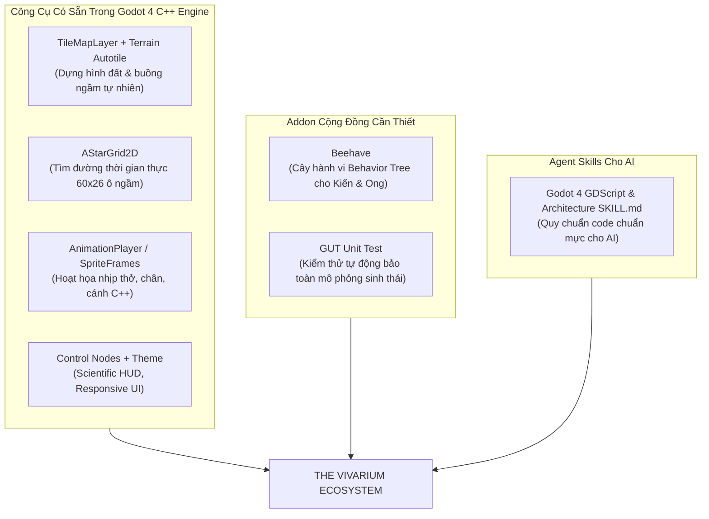
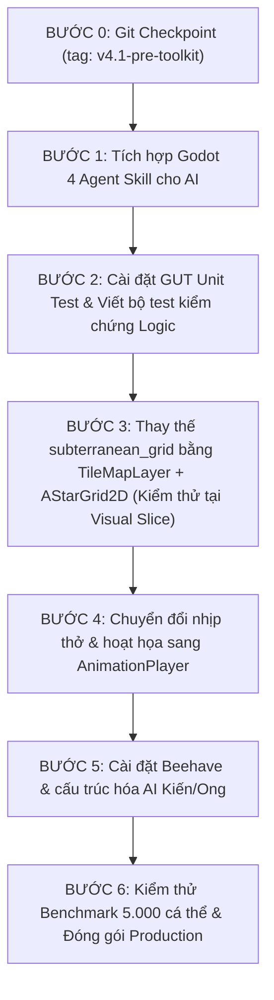

# GODOT TOOLKIT AUDIT — THE VIVARIUM
**Kiểm Toán Hệ Sinh Thái Công Cụ & Kiến Trúc Godot 4 — Chấm Dứt Tình Trạng "Phát Minh Lại Bánh Xe"**

> **Ngày thực hiện:** 18/10/2026  
> **Chuyên viên:** Senior Godot Engine Developer & Tooling Specialist  
> **Trạng thái:** Giai đoạn 1 — Nghiên cứu, đánh giá & đề xuất kiến trúc (CHƯA CÀI ĐẶT)  
> **Dự án mục tiêu:** `The Vivarium` (Godot 4.7.2-stable, GL Compatibility, 16:9 Landscape Sandbox)

---

## 1. Kiểm Tra Môi Trường & Thực Trạng Dự Án

### 1.1. Thông số Kỹ thuật Môi trường
- **Godot Engine:** `v4.7.2.stable.official.ed1daf0bf` (Cài đặt qua WinGet, hỗ trợ đầy đủ tính năng Godot 4.3 - 4.7 mới nhất).
- **Renderer:** `gl_compatibility` (Tối ưu hóa độ tương thích phần cứng, chạy mượt mà trên card rời RTX 2060 SUPER lẫn card tích hợp).
- **Thư mục Plugin (`addons/`):** **Chưa có (None)**. Toàn bộ logic hiển thị, địa hình, animation, và di chuyển hiện tại đều đang được viết thủ công từ con số 0.
- **Antigravity Skills & MCP:** Đã kích hoạt các plugin nền tảng (`chrome-devtools`, `data-agent-kit`, `firebase`, `gemini-api`, `google-antigravity-sdk`). Chưa có Skill hoặc MCP chuyên biệt cho Godot Engine trong workspace.
- **Kết nối Mạng:** Toàn quyền truy cập Internet (tìm kiếm web, clone GitHub, tải Asset Library, nạp dependency).

### 1.2. Vấn Đề Cốt Lõi: Đang "Phát Minh Lại Bánh Xe" Ở Đâu?
1. **Địa hình & Dựng hình (`subterranean_grid.gd`)**:
   - *Hiện trạng:* Đang tự viết vòng lặp `_draw()` duyệt qua 60 × 26 = 1.560 ô, thủ công gọi `draw_texture_rect_region()` và vẽ từng đường viền bóng đổ `draw_line(..., 2.5)`.
   - *Hậu quả:* Bỏ phí hệ thống **`TileMapLayer`** tối ưu hóa bằng C++ của Godot (batching draw calls, quad-tree culling, autotiling, physics).
2. **Tìm đường & Di chuyển (`vivarium_world.gd`)**:
   - *Hiện trạng:* Đang dùng mảng toạ độ tĩnh cố định (`vertical_slice_ant_path`, `tunnel_path_royal_to_nursery`). Khi người chơi đào ô đất mới, kiến không thể tự tính đường đi qua ô đó nếu không có code tìm đường thủ công.
   - *Hậu quả:* Bỏ phí lớp **`AStarGrid2D`** viết bằng C++ có sẵn trong Godot 4 được thiết kế chuẩn xác cho lưới ô vuông đào đất.
3. **Hoạt họa (Animation)**:
   - *Hiện trạng:* `realistic_queen_ant.gd` tự viết nhịp thở bằng hàm lượng giác trong `_process()`: `breath_phase += delta * 2.2; sprite.scale = ...`.
   - *Hậu quả:* Tốn tài nguyên CPU xử lý GDScript mỗi khung hình, không thể dùng visual timeline hoặc phối hợp blend tree.
4. **Hành vi cá thể (Swarm AI)**:
   - *Hiện trạng:* Logic if/else rải rác trong `realistic_ant.gd` và `realistic_bee.gd`. Khi thuộc địa mở rộng lên 5.000 cá thể với các vai trò (kiếm ăn, đào đất, nuôi ấu trùng, bảo vệ), code sẽ trở thành "spaghetti".

---

## 2. Bảng Đánh Giá Chi Tiết Các Công Cụ & Thư Viện

| Tên Công Cụ / Tính Năng | Loại | URL / Nguồn | License | Tương Thích | Tình Trạng | Đánh Giá Tích Hợp Vào Dự Án | Tiết Kiệm Thời Gian? |
| :--- | :--- | :--- | :--- | :--- | :--- | :--- | :--- |
| **Godot 4 `TileMapLayer` + Terrains** | **Built-in Engine** | [Godot Docs](https://docs.godotengine.org/en/stable/classes/class_tilemaplayer.html) | MIT (Godot) | 4.3+ / 4.7 | Native C++ | **Cực cao**. Thay thế hoàn toàn hàm `_draw()` của `subterranean_grid.gd`. Tự động bo góc hầm ngầm bằng Bitmask. | **Rất lớn** (Bỏ 200 dòng vẽ thủ công). |
| **Godot 4 `AStarGrid2D`** | **Built-in Engine** | [Godot Docs](https://docs.godotengine.org/en/stable/classes/class_astargrid2d.html) | MIT (Godot) | 4.0 - 4.7 | Native C++ | **Cực cao**. Quản lý lưới 60×26, đào đất chỉ cần `set_point_solid(cell, false)`. Hỗ trợ Jump Point Search cực nhanh. | **Rất lớn** (Không cần tự viết thuật toán tìm đường). |
| **Godot 4 `AnimationPlayer` / `AnimationTree`** | **Built-in Engine** | [Godot Docs](https://docs.godotengine.org/en/stable/classes/class_animationplayer.html) | MIT (Godot) | 4.0 - 4.7 | Native C++ | **Cực cao**. Dành cho nhịp thở kiến chúa, cánh ong đập, chân kiến bước. Chạy native C++ tốn 0% overhead GDScript. | **Lớn** (Trực quan hóa timeline). |
| **Beehave** | **Community Addon** | [bitbrain/beehave](https://github.com/bitbrain/beehave) | MIT | 4.0 - 4.7 | Active (v2.x) | **Cao**. Behavior Tree bằng GDScript thuần. Trực quan hoá cây hành vi của kiến và ong thành các Node (`Selector`, `Sequence`). | **Lớn** (Quản lý AI thuộc địa đa vai trò sạch sẽ). |
| **LimboAI** | **Community Addon / GDExtension** | [limbonaut/limboai](https://github.com/limbonaut/limboai) | MIT | 4.2 - 4.7 | Very Active | **Trung bình - Cao**. C++ Behavior Tree & State Machine siêu nhanh, có visual debugger trong Editor. Rủi ro: cần GDExtension nhị phân. | **Lớn** nếu số cá thể vượt 10.000 con. |
| **SmartShape2D** | **Community Addon** | [SirRamEsq/SmartShape2D](https://github.com/SirRamEsq/SmartShape2D) | MIT | 4.0 - 4.7 | Active | **Trung bình**. Tạo bề mặt địa hình uốn lượn bằng Bezier Curve có viền rêu cỏ. Phù hợp mặt đất tự nhiên bên trên. | **Trung bình** (Chỉ dùng cho mặt đất outworld). |
| **GUT (Godot Unit Test)** | **Community Addon** | [bitwes/Gut](https://github.com/bitwes/Gut) | MIT | 4.0 - 4.7 | Very Active (v9.x) | **Rất cao**. Framework kiểm thử tự động chuẩn của Godot 4. Chạy CLI headless kiểm tra logic mô phỏng sinh thái và save/load. | **Cực lớn** (Bảo vệ dự án khỏi regression bug). |
| **`jame581/GodotPrompter` / `thedivergentai/Game-Dev-Agentic-Skills`** | **Agent Skill** | [GitHub Skills](https://github.com/thedivergentai/Game-Dev-Agentic-Skills) | MIT | Godot 4.x | Active | **Rất cao**. Cung cấp file `SKILL.md` chuẩn cho AI assistant: ép tuân thủ quy tắc GDScript 4, cấu trúc Node chuẩn, cấm viết anti-patterns. | **Cực lớn** (Ngăn chặn AI tự biên tự diễn). |

---

## 3. Kiến Trúc Đề Xuất: "THE VIVARIUM DEVELOPMENT TOOLKIT"

Sau khi rà soát toàn bộ, chúng tôi đề xuất **bộ công cụ tinh gọn (Lean Toolkit)** chỉ giải quyết đúng 6 vấn đề trọng tâm của dự án:



### 3.1. Chi Tiết Lựa Chọn Từng Hạng Mục:

#### 1. Địa hình có thể đào & lấp + Buồng hang tự nhiên:
- **Giải pháp:** Sử dụng **Godot 4 Native `TileMapLayer`** kết hợp **Terrain Sets (Autotiling)**.
- **Tại sao không cần cài plugin bên ngoài?**  
  Bản thân Godot 4.3+ đã tách `TileMap` thành các `TileMapLayer` riêng biệt cực nhẹ. Tính năng Terrain Autotiling dùng thuật toán 2x2 hoặc 3x3 minimal bitmask: khi ta gọi lệnh `set_cells_terrain_connect()`, engine tự động chọn tile viền đất, tile vách hang, và tile góc nối mượt mà mà không cần vẽ thủ công dù chỉ 1 dòng code!

#### 2. Dẫn đường cho kiến đào bới (Pathfinding):
- **Giải pháp:** Sử dụng **Godot 4 Native `AStarGrid2D`**.
- **Tại sao tối ưu vượt trội?**  
  Lòng đất Vivarium là lưới 60×26 ô vuông. `AStarGrid2D` viết bằng C++ thuần, hỗ trợ Jump Point Search (JPS). Khi kiến đào 1 ô đất sét:
  ```gdscript
  astargrid.set_point_solid(grid_pos, false)
  ```
  Ngay lập tức toàn bộ 5.000 con kiến có đường đi mới trong thời gian chưa đầy vài microsecond!

#### 3. Sprite & Animation đồng bộ:
- **Giải pháp:** Sử dụng **`AnimationPlayer`** và **`AnimatedSprite2D`** có sẵn.
- **Cải tiến:**  
  Chuyển toàn bộ animation co bóp bụng kiến chúa, vẫy râu, rung cánh ong từ hàm `_process()` bằng code sang Track Animation của `AnimationPlayer`.

#### 4. Trí tuệ bầy đàn (Swarm AI):
- **Giải pháp:** Cài đặt **`Beehave`** (MIT License, pure GDScript).
- **Tại sao chọn Beehave thay vì LimboAI?**  
  `Beehave` viết bằng 100% GDScript, không phụ thuộc file nhị phân GDExtension, hoạt động mượt mà trên cả bản xuất Web/Mobile/Desktop và không bị lỗi compile trên Windows. Cây hành vi (Behavior Tree) dạng Node giúp dễ dàng phân chia:
  - *Kiến kiếm ăn:* `Tìm hạt -> Nhặt hạt -> Mang về kho Granary -> Quay lại`.
  - *Kiến đào hầm:* `Nhận mục tiêu Dig -> Đi tới ô đất -> Cắn vỡ -> Tha bùn lên mặt cạn`.

#### 5. Camera, HUD & UI:
- **Giải pháp:** Sử dụng hệ thống **Godot Control Nodes** kết hợp **Theme & StyleBoxFlat**.
- **Hiện trạng:** ScientificHUD đã được xây dựng bằng `MarginContainer`, `HBoxContainer`, `PanelContainer` rất chuẩn. Chỉ cần chuẩn hoá Theme để tránh hardcode màu sắc rải rác.

#### 6. Kiểm thử tự động (Regression Testing):
- **Giải pháp:** Cài đặt **`GUT` (Godot Unit Test)**.
- **Lợi ích:** Đảm bảo mỗi khi thay đổi đồ họa hay tích hợp addon, chỉ cần chạy lệnh `gut` là biết ngay hệ thống mô phỏng 4 loại mật hoa, Swarm Homeostasis và Firebase Sync có bị lỗi hay không.

---

## 4. Phân Loại Hệ Thống Dự Án

### 4.1. Những Hệ Thống BẮT BUỘC GIỮ LẠI (Không Được Thay Thế)
1. **`GameManager` (`scripts/core/game_manager.gd`)**: Chứa toàn bộ "trái tim" sinh học của game: tính toán cân bằng nội môi bầy đàn (Homeostasis), tỷ lệ mật 4 loài hoa, tài nguyên, dân số, độ ẩm, nhiệt độ.
2. **`FirebaseSync` (`scripts/core/firebase_sync.gd`)**: Cơ chế Dual-Save đồng bộ thời gian thực với Cloud Firebase RTDB Singapore (`asia-southeast1`).
3. **`StoryManager` (`scripts/narrative/story_manager.gd`)**: Kịch bản sinh thái và tiến trình mở khóa sinh học.
4. **Bộ 7 Asset Stylized 2D Vẽ Tay (`assets/sprites/stylized_*.png`)**: Đất mùn, cây sồi, hoa cỏ, tổ ong, buồng kiến, kiến thợ, ong thợ. Đồ họa này đã chuẩn và không cần vẽ lại.

### 4.2. Những Hệ Thống NÊN THAY THẾ Bằng Giải Pháp Có Sẵn
1. **`subterranean_grid.gd` -> Chuyển sang `TileMapLayer`**:
   - *Lý do:* Loại bỏ hoàn toàn 200 dòng code thủ công tính toán pixel region và `draw_line()`.
2. **Hardcoded Waypoints -> Chuyển sang `AStarGrid2D`**:
   - *Lý do:* Thay thế các mảng tĩnh `tunnel_path_royal_to_nursery` bằng thuật toán tìm đường C++ tự động thích ứng khi địa hình thay đổi.
3. **`realistic_queen_ant.gd` breathing math -> Chuyển sang `AnimationPlayer`**:
   - *Lý do:* Giải phóng CPU khỏi vòng lặp `sin()` GDScript mỗi frame.

---

## 5. Danh Sách Asset & Công Cụ Cần Bổ Sung

1. **Tileset Spritesheet cho Địa Hình Đào Bới**:
   - Để `TileMapLayer` autotile hoạt động hoàn hảo, cần 1 bảng tileset autotile 16-tile hoặc 48-tile (Terrain Autotile Wang/Blob) tạo từ texture `stylized_handpainted_soil.png`.
2. **Godot 4 Agent Skill (`SKILL.md`) Trong Workspace**:
   - Thiết lập một file quy chuẩn hướng dẫn AI trong thư mục `.gemini/` hoặc `skills/godot4-dev/SKILL.md` để đảm bảo mọi đoạn code AI viết ra luôn tuân thủ chuẩn GDScript 4 (Static typing, Signals, Node composition, không tự viết lại tính năng có sẵn).

---

## 6. Lộ Trình Tích Hợp An Toàn (Safe Integration Roadmap)

Tuyệt đối tuân thủ nguyên tắc: **TỪNG BƯỚC MỘT — CÓ CHECKPOINT — KIỂM THỬ ĐỘC LẬP TRƯỚC KHI GHÉP VÀO GAME CHÍNH**.



- **Bước 0:** Tạo checkpoint Git `git tag v4.1-pre-toolkit`.
- **Bước 1:** Nạp Agent Skill hướng dẫn phát triển Godot 4 chuẩn hóa vào workspace.
- **Bước 2:** Cài đặt addon `GUT` vào `addons/gut`, viết test suite tự động kiểm tra `GameManager` và `FirebaseSync`.
- **Bước 3:** Tạo nhánh prototype thay thế `subterranean_grid` bằng `TileMapLayer` + `AStarGrid2D`. Chạy kiểm thử tại scene `visual_vertical_slice.tscn` trước. Khi đạt 60+ FPS và đào/lấp mượt mà mới đưa sang `main.tscn`.
- **Bước 4:** Tạo `AnimationPlayer` cho kiến chúa, ong thợ, kiến thợ.
- **Bước 5:** Tích hợp `Beehave` cho phân vai thợ đào, thợ kiếm ăn, kiến lính.
- **Bước 6:** Chạy lại benchmark Swarm Stress Test đảm bảo vẫn giữ vững 400 - 1.800+ FPS trên 1.000 - 5.000 cá thể.
